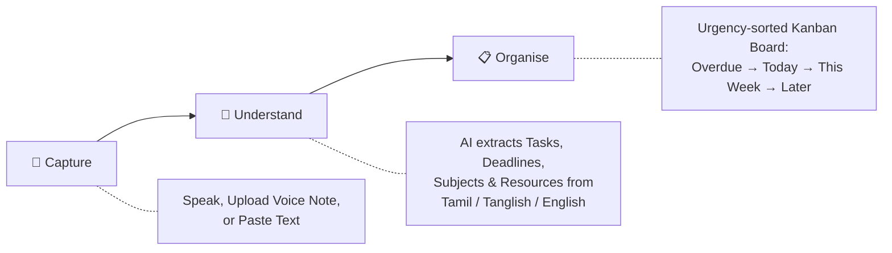
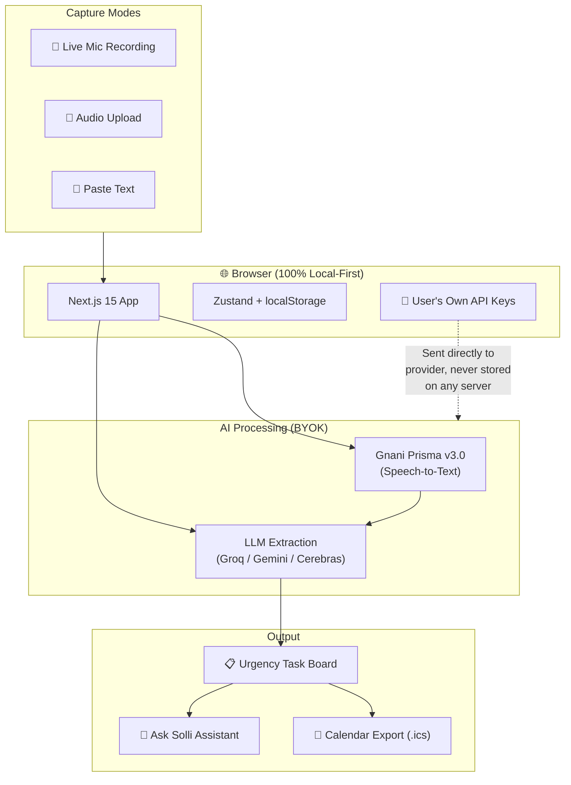

# 🎯 Solli — One Voice Note In, Structured Tasks Out

### The Great Indian AI Internship Challenge 2026 | Built by Thanigai Velan

---

## 📌 The Problem (It's Personal)

Professors announce 5 assignments, 3 deadlines, and a lab submission — **all in one breath** — in a rapid mix of Tamil and English. Nothing is written on the board. Nothing is on the LMS.

Students walk out thinking *"I'll remember this."*

**They don't.**

By 11 PM, the WhatsApp group is flooded: *"Bro, DBMS assignment Chapter 7 aa 8 aa?"* *"OS report deadline Friday aa Thursday aa?"*

I've been that student. I missed deadlines this way. **Solli exists because I got tired of losing marks to bad memory.**

---

## 💡 The Solution

**Solli** turns a single spoken classroom announcement — in Tamil, Tanglish, Hinglish, or English — into a **structured, urgency-sorted task board** in seconds.

> *"Solli"* (சொல்லி) means "the one who told" in Tamil. Your professor *solli* (told you). This app makes sure you don't forget what was *solli*.

### How It Works — In 3 Steps



---

## 🔥 Live Example

**Professor says** *(in a single rapid-fire announcement)*:

> *"DBMS assignment-ah Chapter 7 padichu, naalaiku submit pannunga. OS lab-ku oru report ezhudhi Friday-kulla kudukanum. Maths tutorial sheet-um innaiku download pannunga."*

**Solli extracts:**

| # | Task | Subject | Deadline | Resource |
|---|------|---------|----------|----------|
| 1 | Submit DBMS Assignment | DBMS | Tomorrow | Chapter 7 |
| 2 | Write and submit OS Lab Report | OS | This Friday | Lab Manual |
| 3 | Download Maths Tutorial Sheet | MATHS | Today | Tutorial Sheet |

Three structured cards. Sorted by urgency. **Zero frantic WhatsApp messages at midnight.**

---

## 🏗️ Architecture



---

## ✨ Key Features

| Feature | What It Does |
|---------|-------------|
| **3 Capture Modes** | Live mic, audio file upload, or paste text — all in one unified flow |
| **Indic Language Extraction** | Parses Tamil, Tanglish, Hinglish, and English code-mixed input into structured tasks |
| **Smart Date Resolution** | Understands *"naalaiku"* (tomorrow), *"Friday-kulla"* (by Friday), *"innaiku"* (today), *"parso"* (day after tomorrow) |
| **Urgency Board** | Auto-sorts into Overdue / Today / This Week / Later / No Date columns |
| **Ask Solli** | Voice or text queries — *"What's due this week?"* — with audio read-back |
| **Calendar Export** | One-click `.ics` download per task or full board → Google Calendar / Outlook |
| **100% Local-First** | Zero database. Zero cloud storage. All data stays in your browser's `localStorage` |
| **BYOK (Bring Your Own Keys)** | Works with free-tier Groq, Google AI Studio, Cerebras, or OpenRouter |
| **Dark / Light Theme** | Campus notebook design with warm paper aesthetic and theme toggle |

---

## 🔐 Privacy-First Design

```
┌─────────────────────────────────────────────┐
│              YOUR BROWSER                    │
│                                              │
│  ┌──────────┐  ┌──────────┐  ┌───────────┐  │
│  │  Tasks   │  │  Keys    │  │  Settings  │  │
│  │  (local) │  │  (local) │  │  (local)   │  │
│  └──────────┘  └──────────┘  └───────────┘  │
│                     │                        │
│              Direct API Call                 │
│              (your key, your request)        │
└─────────────────┬───────────────────────────┘
                  │
          ┌───────▼────────┐
          │  LLM Provider  │   ← Groq / Gemini / Cerebras
          │  (processes &   │
          │   forgets)      │
          └────────────────┘

          No server database. No analytics.
          No cloud logging. Period.
```

---

## 🛠️ Tech Stack

| Layer | Technology |
|-------|-----------|
| Framework | Next.js 15 (App Router) |
| Language | TypeScript (Strict Mode) |
| Styling | Tailwind CSS + Custom Design Tokens |
| State | Zustand (persisted in localStorage) |
| Animation | Motion (motion.dev) |
| Validation | Zod |
| Dates | date-fns |
| Speech | Web Speech API + Gnani Prisma v3.0 |
| Icons | Lucide React |

---

## 🚀 Quick Start

```bash
git clone https://github.com/THANIGAI-VELAN/Great-Indian-AI-intership-challenge-.git
cd Great-Indian-AI-intership-challenge-

npm install
npm run dev
```

Open `http://localhost:3000` →
- **`/`** — Marketing Landing Page
- **`/board`** — Interactive Task Board

**To use AI extraction:** Paste a free Groq API key (or Google AI Studio key) in Settings. That's it — under 3 minutes to your first task card.

---

## 🎯 Why This Matters

| The Gap | Solli's Answer |
|---------|---------------|
| Meeting bots (Otter, Fireflies) assume English-only meetings | Solli handles code-mixed Tamil-English classroom announcements |
| To-do apps let you dictate *one* task in English | Solli extracts *multiple* tasks with dates and resources from *one* message |
| WhatsApp transcription gives raw text | Solli gives structured, dated, sorted task cards |
| Most tools need accounts and cloud storage | Solli is 100% local-first with zero sign-up |

**The gap is not transcription. It's: mixed-language speech in → structured, dated tasks out → displayed in a way the student trusts.**

---

## 📂 Project Structure

```
src/
├── app/              # Next.js App Router (pages + API routes)
│   ├── page.tsx      # Marketing landing page
│   ├── board/        # Task board dashboard
│   └── api/          # LLM & STT proxy routes
├── components/       # React components (capture, board, cards, assistant)
├── lib/              # Core logic (extraction, providers, calendar, store)
└── styles/           # Global styles and design tokens
docs/
├── decisions.md      # Architecture decision log
├── design-system.md  # Design tokens and visual system
└── progress.md       # Build milestone tracker
```

---

<p align="center">
  <b>Built with care by Thanigai Velan</b><br/>
  <i>The Great Indian AI Internship Challenge 2026</i><br/><br/>
  Speech services powered by <a href="https://gnani.ai">Gnani.ai</a>
</p>
